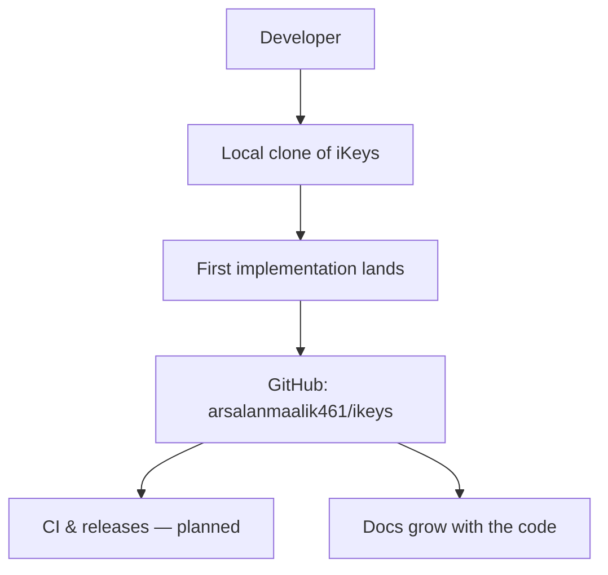

<p align="center">
  
</p>

<p align="center">
  
  
</p>

> **Developed by [Arslan Malik](https://github.com/arsalanmaalik461)**
> 📱 WhatsApp: [+92 300 8987448](https://wa.me/923008987448) · 🌐 Website: [arslanmalik.tech](https://arslanmalik.tech)

---

## 🌟 Executive Overview

**iKeys** is a brand-new starter repository from Arslan Malik. It is currently at day zero — an empty canvas waiting for its first real commit beyond this README. The repository exists to give a future project a clean, well-documented home from the very beginning, rather than bolting documentation on at the end.

Nothing about the implementation is decided yet except the standard of quality: every project under this account ships with clear documentation, branded assets, and honest notes about what it is and what it is not. When the first real code lands here, this README will grow with it — the overview, features, and architecture sections will be rewritten to describe the actual implementation instead of the plan.

If you found this repository through GitHub, you are early. Star it, check back later, or reach out on WhatsApp if you have an idea for what iKeys should become — the best time to influence a project is before line one.

---

## 📑 Table of Contents

- [✨ Key Features & Highlights](#-key-features--highlights)
- [🖥️ Feature Showcase](#️-feature-showcase)
- [🏗️ System Architecture](#️-system-architecture)
- [🚀 Quickstart & Installation Guide](#-quickstart--installation-guide)
- [📂 Project Structure](#-project-structure)
- [🛡️ Security & Notes](#️-security--notes)

---

## ✨ Key Features & Highlights

> ℹ️ The project has no implementation yet — the highlights below describe the standards and plans in place from day one.

| Feature | Description |
| :--- | :--- |
| 📖 README-first development | Documentation is written before code; every future module gets documented before it merges |
| 🗺️ Roadmap-driven | Features will be specified in this README before they are built — no mystery code |
| 🛡️ Security-first hygiene | No secrets, tokens, or credentials will ever be committed to this repository |
| 🧹 Clean git history | Conventional commits from the very first push, so the history stays readable |

---

## 🖥️ Feature Showcase

### 1. README-First Development

> "Documentation is the first feature."

- Branded banner, shields, and table of contents are already in place
- Installation guide, project structure, and security notes ship with the repo — not after it
- Every future module will get its own documented section before merging

### 2. Shape the Roadmap

> "The best time to influence a project is before line one."

- The direction of iKeys is still open — ideas and feedback are welcome
- Reach out directly on WhatsApp: [+92 300 8987448](https://wa.me/923008987448)
- Or explore more work at [arslanmalik.tech](https://arslanmalik.tech)

---

## 🏗️ System Architecture

> Current state and planned workflow — this diagram will be replaced with the real architecture once the implementation lands.



---

## 🚀 Quickstart & Installation Guide

### Prerequisites

- [Git](https://git-scm.com/) installed on your machine

### Step-by-Step Installation

```bash
# 1. Clone the repository
git clone https://github.com/arsalanmaalik461/ikeys.git

# 2. Enter the project directory
cd ikeys

# 3. The first real code hasn't landed yet — check back soon,
#    or open an issue / message on WhatsApp to get involved.
```

Once the implementation is published, this section will carry the real stack-specific setup steps.

---

## 📂 Project Structure

```
ikeys/
├── README.md              # You are here
└── docs/
    └── assets/
        └── banner.svg     # Branded project banner
```

---

## 🛡️ Security & Notes

- 🔑 **Never commit secrets** — API keys, tokens, passwords, or private keys must never enter this repository. Use environment variables or a secret manager instead.
- 📝 Add a `.gitignore` appropriate to the stack before the first code commit.
- 🐞 Found something odd? Open a GitHub issue or message on [WhatsApp](https://wa.me/923008987448).
- ⚠️ This is an early-stage project provided as-is, with no warranty. Features described as "planned" are intentions, not promises.

---

<p align="center">
  <sub>Developed with ❤️ by <a href="https://github.com/arsalanmaalik461">Arslan Malik</a> · 📱 <a href="https://wa.me/923008987448">WhatsApp: +92 300 8987448</a> · 🌐 <a href="https://arslanmalik.tech">arslanmalik.tech</a></sub>
</p>
